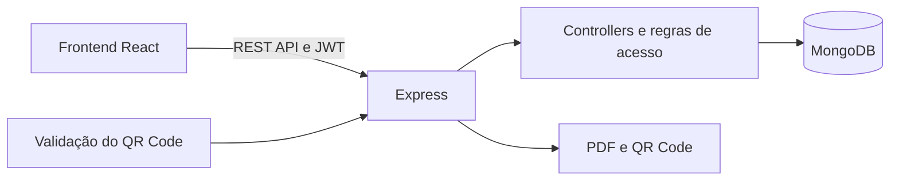

# BO Online — API Backend

API do sistema **BO Online do 4º BPM / PMMA**. O serviço implementa autenticação, regras de acesso, operações de boletins, estatísticas, emissão e validação de documentos. A persistência é feita em MongoDB por meio do Mongoose.

Frontend correspondente: [boonline4bpm](https://github.com/jairomartins/boonline4bpm).

## Visão geral



### Recursos principais

- Login, cadastro, confirmação de e-mail, recuperação de senha e autenticação por JWT.
- Cadastro, consulta e atualização de boletins, com envolvidos, natureza, materiais, efetivo e histórico.
- Perfis e permissões configuráveis, validados no servidor a cada requisição protegida.
- Catálogo oficial de naturezas e associação com registros antigos.
- Estatísticas e consultas geográficas para o mapa.
- Emissão de cópia digital em PDF com QR Code, histórico de versões e validação pública limitada.
- Revisão de texto opcional por integração com OpenAI.
- Documentação HTTP interativa em `/docs`.

## Tecnologias

Node.js, Express, MongoDB, Mongoose, JWT, Nodemailer, PDFKit, QRCode e OpenAI SDK.

## Banco de dados e preservação dos dados

A conexão atual está definida em `src/database/db.js`:

```text
mongodb://127.0.0.1:27017/boonline
```

Isso significa que a aplicação usa o banco MongoDB chamado `boonline` no próprio servidor. A conexão ainda não é lida de uma variável `MONGODB_URI`. Um banco separado chamado `boletims`, por exemplo, não é selecionado automaticamente por esta configuração.

Antes de conectar uma nova instalação a um MongoDB existente, confirme o endereço e o nome do banco e mantenha um backup restaurável. Não execute comandos de remoção de banco/coleções nem restaure um dump sobre dados existentes sem conferir o destino. Os scripts de migração não são executados automaticamente ao iniciar a API.

## Executar localmente

Pré-requisitos: Node.js, npm e um MongoDB acessível em `127.0.0.1:27017`.

1. Instale as dependências na raiz:

   ```bash
   npm ci
   ```

2. Crie um arquivo `.env` na raiz. Exemplo para desenvolvimento:

   ```env
   PORT=3000
   BASE_URL=localhost
   USE_HTTPS=false
   SECRET_PASSWORD_TOKEN=gere-uma-chave-longa-e-aleatoria
   PUBLIC_VALIDATION_BASE_URL=http://localhost:3000
   EMAIL_USER=
   EMAIL_PASSWORD=
   OPENAI_API_KEY=
   ```

   `SECRET_PASSWORD_TOKEN` deve ser uma chave privada, longa e exclusiva. E-mail e OpenAI são usados apenas pelos recursos correspondentes. O envio de e-mail está configurado no código para SMTP do Gmail na porta 587. Não envie o arquivo `.env` ao Git.

3. Inicie a API:

   ```bash
   npm run dev
   ```

   Para iniciar sem reinicialização automática, use `npm start`. Com a configuração padrão, a API responde em `http://localhost:3000`; verifique `/` para a resposta de disponibilidade e `/docs` para a documentação HTTP.

## Endpoints principais

As rotas de autenticação estão disponíveis sob `/auth` e também mantêm os caminhos legados sem esse prefixo. Rotas protegidas recebem o JWT no cabeçalho `x-access-token`.

| Grupo | Rotas de referência | Acesso |
|---|---|---|
| Autenticação | `POST /auth/login`, `POST /auth/register`, `GET /auth/confirm/:token`, `POST /auth/recuperarSenha`, `POST /auth/passwordrecover/:token`, `GET /auth/session` | Algumas operações são públicas; sessão requer token |
| Usuários | `/user`, `/user/me`, `/user/:id` | Login e permissões conforme a operação |
| Perfis e permissões | `/access/me`, `/access/roles`, `/access/users/:id/role`, `/access/users/:id/status` | Requer permissões administrativas |
| Boletins | `/incidentReport/search`, `/incidentReport/create`, `/incidentReport/:id`, `/incidentReport/remove/:id` | Requer login e permissões |
| Estatísticas e mapa | `GET /incidentReport/statistics`, `GET /incidentReport/statistics/geographic/options`, `GET /incidentReport/statistics/geographic` | Requer permissões de estatística/mapa |
| Naturezas | `/naturezas`, `/naturezas/:id`, `/naturezas/:id/status` | Consulta requer login; alterações exigem permissão |
| PDF e validação por QR | `POST /incidentReport/:id/documents`, `GET /incidentReport/documents/validation/:token` | Emissão autenticada; validação básica pública e limitada |
| Revisão de texto | `POST /api/verify-text` | Requer `OPENAI_API_KEY` configurada |

A API documenta os parâmetros e os demais endpoints em `/docs`. A consulta pública do QR Code confirma o estado do documento, sem liberar o conteúdo integral do boletim. PDF e detalhes completos exigem autenticação e autorização.

## Scripts

| Comando | Comportamento |
|---|---|
| `npm run dev` | Inicia com Nodemon |
| `npm start` | Inicia a API |
| `npm test` | Executa os testes automatizados com `node --test` |
| `npm run migrate:roles` | Cria/atualiza os perfis iniciais e associa usuários; altera o banco |
| `npm run migrate:naturezas` | Simula por padrão a associação de naturezas legadas; use `-- --apply` para gravar |
| `npm run seed:naturezas` | Simula por padrão a inclusão das naturezas ausentes; use `-- --apply` para gravar |
| `npm run migrate:incident-dates` | Faz uma leitura de conferência por padrão; para gravar exige `-- --apply` e `CONFIRM_INCIDENT_DATE_BACKFILL=yes` |

Revise o código e o relatório dos scripts antes de aplicá-los a dados existentes. Faça backup recente e confirme que a configuração aponta para o banco correto. Mesmo a simulação de datas acessa e lê o MongoDB, embora não grave alterações.

## Considerações para produção

- O servidor usa `cors()` sem lista de origens neste momento; restrinja o CORS aos domínios do frontend antes de expor a API publicamente.
- Quando `USE_HTTPS=true`, o código lê certificados de um caminho Let's Encrypt fixo em `src/index.js`. Para TLS terminado em proxy reverso, mantenha a API atrás do proxy e revise o comportamento de geração de links de e-mail e de validação.
- O limitador da validação pública do QR Code mantém contadores em memória. Se operar com várias instâncias, será necessário compartilhar esse estado.
- Restrinja o acesso de rede ao MongoDB; o frontend não deve conectar diretamente à porta do banco.
- Use HTTPS público para o frontend e para os links de validação dos documentos. Mantenha segredos e arquivos de certificado fora do repositório.

## Estrutura do código

- `src/index.js`: inicialização do Express e seleção HTTP/HTTPS.
- `src/http/`: definição das rotas.
- `src/controllers/`: fluxos e regras da API.
- `src/model/`: schemas Mongoose.
- `src/database/`: conexão com MongoDB.
- `src/utils/` e `src/lib/`: permissões, validações e integrações.
- `src/scripts/`: migrações e carga de catálogos.
- `src/assets/`: imagens usadas em documentos.

## Licença

O pacote backend declara a licença MIT em seu `package.json`.
